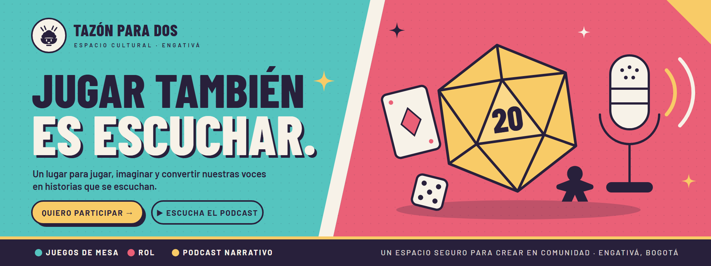

# Tazón para Dos · Kit de marca

> **Jugar también es escuchar.** Espacio cultural LGBTI+ en Engativá, Bogotá: juegos de rol, juegos de mesa y podcast narrativo.



Este repositorio reúne la identidad visual de [Tazón para Dos](https://tazon-para-dos.online/): logos, colores, íconos, ilustraciones y plantillas para redes e impresión. Incluye también documentación para que una IA pueda crear piezas nuevas siguiendo las mismas reglas.

## ¿Por dónde empiezo?

| Si eres… | Abre |
|---|---|
| Una persona que quiere ver todo de un vistazo | [`index.html`](index.html) en el navegador |
| Una persona que quiere hacer una publicación | El [editor de plantillas](https://thetrashkat.github.io/tazon-para-dos-marca/editor/): cambias los textos y descargas el PNG |
| Una persona que va a diseñar algo | [`MANUAL_DE_MARCA.md`](MANUAL_DE_MARCA.md) |
| Una persona que quiere el **modo oscuro** (Tinieblas) | La sección 16 del manual y el [kit Tinieblas](https://thetrashkat.github.io/tazon-para-dos-tinieblas/) |
| Una persona que quiere maquetar una **historia** o una **pancarta** | El [editor de historias](https://thetrashkat.github.io/historias-tazon/editor/) o el [de pancartas](https://thetrashkat.github.io/historias-tazon/editor/pancarta.html) |
| Una IA o alguien programando | [`AGENTS.md`](AGENTS.md), [`brand/tokens.json`](brand/tokens.json) y [`brand/brand.json`](brand/brand.json) |

## Contenido

```
brand/          tokens.json · tokens.css · brand.json (fuente de verdad) · tinieblas/ (modo oscuro)
assets/logo/    mascota, sello, logotipos (+ inversos), favicon, png/ transparentes
assets/iconos/  21 íconos de línea 64 px + sprite.svg
assets/elementos/ d20, d6, carta, meeple, micrófono, destello
plantillas/     posts, historias, carrusel, evento, destacadas, perfil, podcast, banner, pancarta
aplicaciones/   stickers, tarjeta, letrero, ficha de personaje, certificado, firma de correo, merch
editor/         editor web de plantillas editables (12 plantillas, exporta PNG/SVG/JSON)
video/          intro y cierre animados (MP4), capas transparentes y tarjetas finales
impresion/      PDF listos para imprenta (tamaño real, fuentes incrustadas)
referencias/    pancarta y logo originales
tools/          build.py (genera SVG) · render.ps1 (PNG) · export.py (PDF, logos PNG, favicon) · fonts/
```

## Paleta

| Tinta | Turquesa | Coral | Sol | Crema |
|---|---|---|---|---|
| `#28203B` | `#55C4BF` | `#EA6077` | `#F8CB67` | `#F7F2E8` |

## Regenerar

```bash
python -I tools/build.py                                   # SVG desde los tokens
powershell -ExecutionPolicy Bypass -File tools/render.ps1  # PNG (Edge/Chrome)
python -I tools/export.py                                  # PDF de imprenta, logos PNG, favicon
python -I tools/render_editor.py editor/ejemplos/semana.json  # PNG desde JSON con el editor
python -I tools/video.py                                   # kit de video (requiere ffmpeg)
python -I tools/montaje.py video/ejemplos/guion_reel_marco.json  # monta un video con tus clips
```

Requiere Python 3 con `fonttools` y `Pillow` (`pip install fonttools pillow`). Para el video hace falta [ffmpeg](https://ffmpeg.org) (`winget install Gyan.FFmpeg`) para convertir a trazos los textos de los logos.

## Licencias

- Marca, mascota y textos: © Tazón para Dos. Todos los derechos reservados.
- Fuentes Barlow: SIL Open Font License (`tools/fonts/OFL.txt`).
